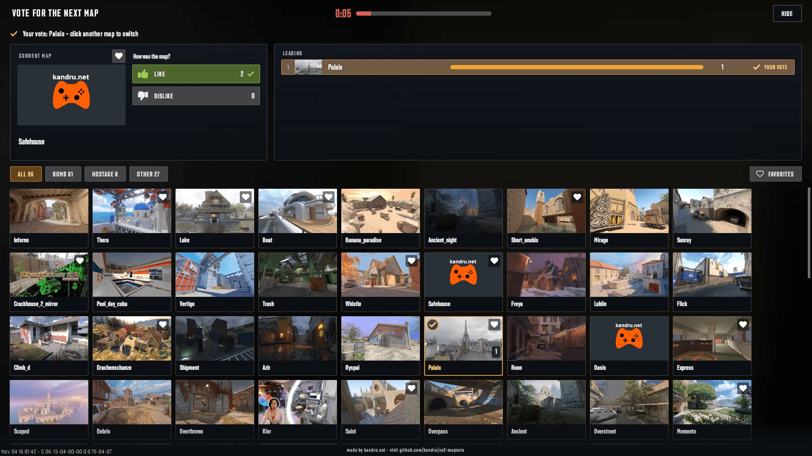

# CounterstrikeSharp - MapVote

> [!TIP]
> Please consider a [donation](https://www.paypal.com/donate/?hosted_button_id=C2AVYKGVP9TRG) when you're using this plugin - it took a long time to build and improve - it only costs you a few dollars and would help me very much!

When the match ends, players should pick the next map the way Valve never intended - big pictures, a clear winner row, and a list you can browse. **MapVote** brings that full-screen vote to your [CounterStrikeSharp](https://docs.cssharp.dev/) server: portrait map cards, a top row of maps that already have votes, filters by type and "most played", favorites, and `!rtv` so the lobby can force a vote early on your map list.

## Installation

1. Install [Metamod:Source](https://www.metamodsource.net/downloads.php?branch=dev).
2. Install [MultiAddonManager](https://github.com/Source2ZE/MultiAddonManager/releases) and load workshop item [3827322946](https://steamcommunity.com/sharedfiles/filedetails/?id=3827322946) (HUD and map pictures), for example `mm_extra_addons "3827322946"` in `game/csgo/cfg/multiaddonmanager/multiaddonmanager.cfg`.
3. Install [CounterStrikeSharp](https://docs.cssharp.dev/).
4. Download the latest release from the [GitHub releases page](https://github.com/Kandru/cs2-mapvote/releases/) and copy the `MapVote` folder into `/game/csgo/addons/counterstrikesharp/plugins/`.
5. Set a non-empty `rcon_password` (the plugin loads the map list over localhost RCON).
6. Restart the server. Config is created at `addons/counterstrikesharp/configs/plugins/MapVote/MapVote.json`.

## Map pictures

The game cannot load map pictures from the plugin folder. They have to live in a **Workshop addon** that the server mounts (step 2 above).

We publish [that addon](https://steamcommunity.com/sharedfiles/filedetails/?id=3827322946) and add new map pictures over time. A map with no picture still shows up with a plain placeholder. If you want your own art, publish your own addon with one picture per map - details are in the [developer docs](docs/images.md).

## How to use it

- At the end of a match, the vote screen opens with a shuffled subset of the catalog (up to 50 maps, scaled by player count); players click a map, and the top row shows the 10 maps with the most votes.
- In chat, type `!rtv` (or `css_rtv` / `rtv`). By default about 60% of humans must agree; then the match ends early so this vote can run.
- Type `!maps` (or `css_maps` / `maps`) to browse the server map list at any time before intermission. Filter, sort, and manage favorites; press `X` to close. The browser closes automatically when the match ends and reopens with the next match or map.
- Config file: `addons/counterstrikesharp/configs/plugins/MapVote/MapVote.json`. Useful knobs: vote length, whether to hide the map just played, RTV on/off and ratio, and which maps appear (`maps_votable`). Full key list: [docs/config.md](docs/config.md).

Changing the plugin code, building, or extracting images: see [docs/](docs/README.md).

## License

Released under [GPLv3](/LICENSE) by [@Kandru](https://github.com/Kandru).

## Authors

- [@derkalle4](https://www.github.com/derkalle4)
