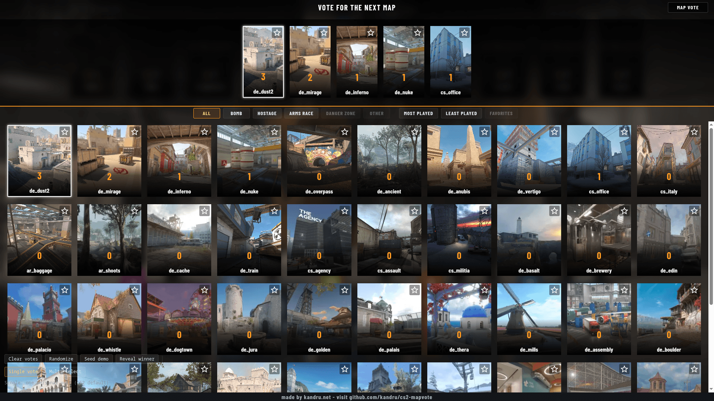

# CounterstrikeSharp - MapVote

[](https://discord.gg/NtHCk5PWEt)
[](https://github.com/Kandru/cs2-mapvote/releases/)
[](#license)
[](https://github.com/Kandru/cs2-mapvote/issues)
[](https://www.paypal.com/donate/?hosted_button_id=C2AVYKGVP9TRG)

> [!TIP]
> Please consider a [donation](https://www.paypal.com/donate/?hosted_button_id=C2AVYKGVP9TRG) when you're using this plugin - it took a long time to build and improve - it only costs you a few dollars and would help me very much!



Panorama end-of-match map vote for [CounterStrikeSharp](https://docs.cssharp.dev/). Players get Valve-style portrait cards, a top row of maps that already have votes, a scrollable catalog with type and sort filters, and `!rtv`.


## Installation

1. Install [Metamod:Source](https://www.metamodsource.net/downloads.php?branch=dev).
2. Install [MultiAddonManager](https://github.com/Source2ZE/MultiAddonManager/releases) and configure it to load workshop item [3827322946](https://steamcommunity.com/sharedfiles/filedetails/?id=3827322946) (Panorama HUD), for example `mm_extra_addons "3827322946"` in `game/csgo/cfg/multiaddonmanager/multiaddonmanager.cfg`.
3. Install [CounterStrikeSharp](https://docs.cssharp.dev/).
4. Download the latest release from the [GitHub releases page](https://github.com/Kandru/cs2-mapvote/releases/) and copy the `MapVote` folder into `/game/csgo/addons/counterstrikesharp/plugins/`.
5. Set a non-empty `rcon_password` (map lists are loaded via localhost RCON).
6. Restart the server. Config is created at `addons/counterstrikesharp/configs/plugins/MapVote/MapVote.json`.

## Build

```bash
make debug      # dockerized dotnet build (runs panorama validation first)
make release    # dockerized dotnet publish
make test       # unit tests
make panorama   # validate XML/CSS/images only
```

Uses `mcr.microsoft.com/dotnet/sdk:10.0` — no project Dockerfile.

## Map images

```bash
# One-time: download VRF CLI 20 into tools/.cache/
# https://github.com/ValveResourceFormat/ValveResourceFormat/releases/download/20.0/cli-linux-x64.zip
make images WORKSHOP_DIR=/path/to/workshop/content/730
make images GAME_DIR=/path/to/Steam/steamapps/common/Counter-Strike\ Global\ Offensive/game/csgo
make images WORKSHOP_DIR=… GAME_DIR=…/game/csgo
make images-check   # rewrite any map tile that is not a 350×197 PNG
# Override binary: make images … SOURCE2VIEWER_CLI=/path/to/Source2Viewer-CLI
```

**Workshop (`WORKSHOP_DIR`):** opens each VPK in path order and only considers packages that ship `maps/*.vmap_c`. It tries map screenshots (`map_icons/screenshots/1080p` → `720p` → `360p`, largest file first). It skips radar/overhead paths, preferring shots that are not too dark (mean luma under 40) and not much taller than wide. If nothing preferred remains, it falls back to the first too-dark screenshot, then the first portrait/tall screenshot (full width kept, vertically centered crop into 16:9). When a map has no screenshot at all, it uses `panorama/images/overheadmaps/{map}_radar_*` (plain radar, then lower/higher floors). Output is `ws_{name}.png` plus `.vtex` under the panorama maps folder, resized to **350×197**, and a `.mv-map-ws_{name}` class. A repeated name becomes `ws_{name}_1`, `_2`, …. Packages with no usable screenshot or overhead are skipped (HUD falls back to `default.png` / `mv-map-default`).

**Official maps (`GAME_DIR`):** reads `pak01_dir.vpk` (pass the `game/csgo` folder or the VPK itself), keeps maps that ship a 360p screenshot except `random` and `lobby_*`, and writes `map_{name}.png` plus `.vtex` in the same panorama folder with `.mv-map-map_{name}` classes. The HUD picks `map_` or `ws_` from the map's origin, so the same name can exist as both.

Requires Pillow. Republish the workshop addon after extracting images.

## Config

`addons/counterstrikesharp/configs/plugins/MapVote/MapVote.json` (generated on first run). Disable the plugin in CounterStrikeSharp if you do not want MapVote at all.

| Key | Default | Meaning |
| --- | --- | --- |
| `debug` | `false` | Extra console logging |
| `endmatch.exclude_current_map` | `true` | Hide the map just played |
| `endmatch.vote_seconds` | `15` | Open voting window (custom menu or native CS2 vote) |
| `endmatch.winner_reveal_seconds` | `5` | Locked-winner hold after our vote (custom menu only) |
| `rtv.enabled` | `true` | `!rtv` / `css_rtv` |
| `rtv.ratio` | `0.6` | Fraction of humans required |
| `filters.enabled` | `true` | Type / sort chip bar |
| `filters.types` | bomb/hostage/… | Prefix (or glob) groups for type chips |
| `filters.sorts` | most/least/favorites | Sort chips: `id`, `by` (`plays`/`name`/`favorite`), `order` (`asc`/`desc`), optional `only` |
| `maps_votable` | (auto) | Per-map vote enable flags. Keys `map_{name}` (server) / `ws_{name}` (workshop); `true` shows, `false` hides. New maps default to `true`; keys for removed maps stay in the file |

## Workshop layout

Copy `workshop/content/` into your `csgo_addons/<addon>/` tree. Layout/style sources are already versioned (`vote_v1.xml`, `hud_v1.vcss`) to match `PanoramaVersion` in `Version.cs`; publish compiles them to `vote_v1.vxml_c` / `hud_v1.vcss_c`. Panorama binding rules live in `stuff/PANORAMA_RULESET.md`.

## Commands

- `!rtv` / `css_rtv` — rock the vote (forces the match to end so this overlay can run)

## License

Released under [GPLv3](/LICENSE) by [@Kandru](https://github.com/Kandru).

## Authors

- [@derkalle4](https://www.github.com/derkalle4)
